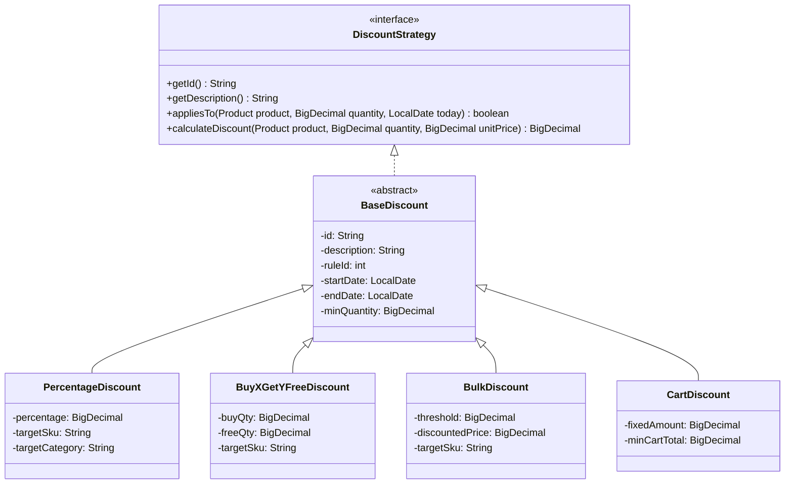
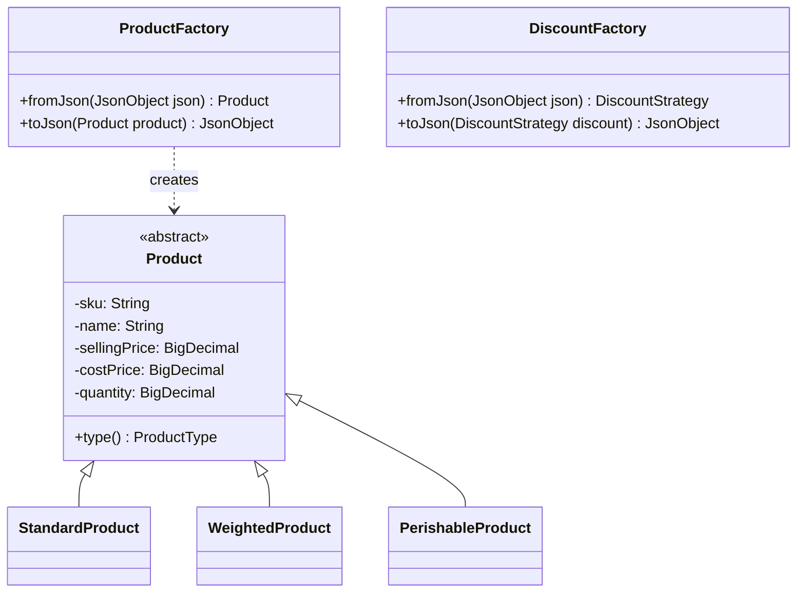
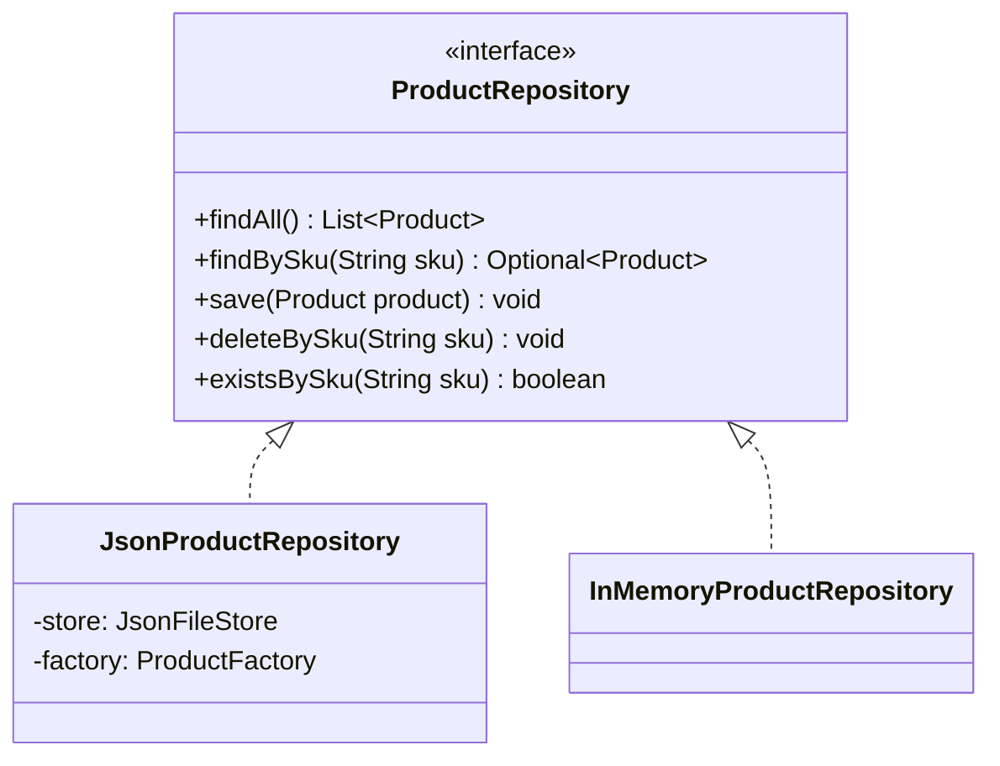
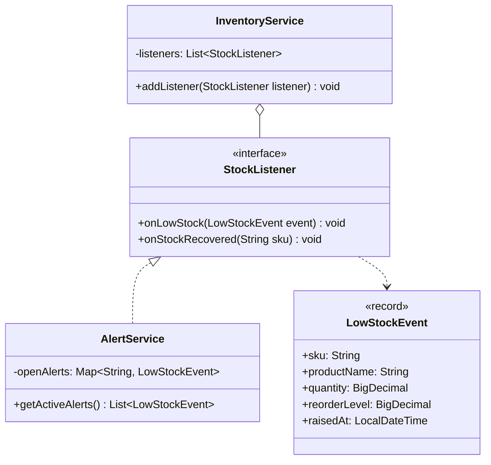
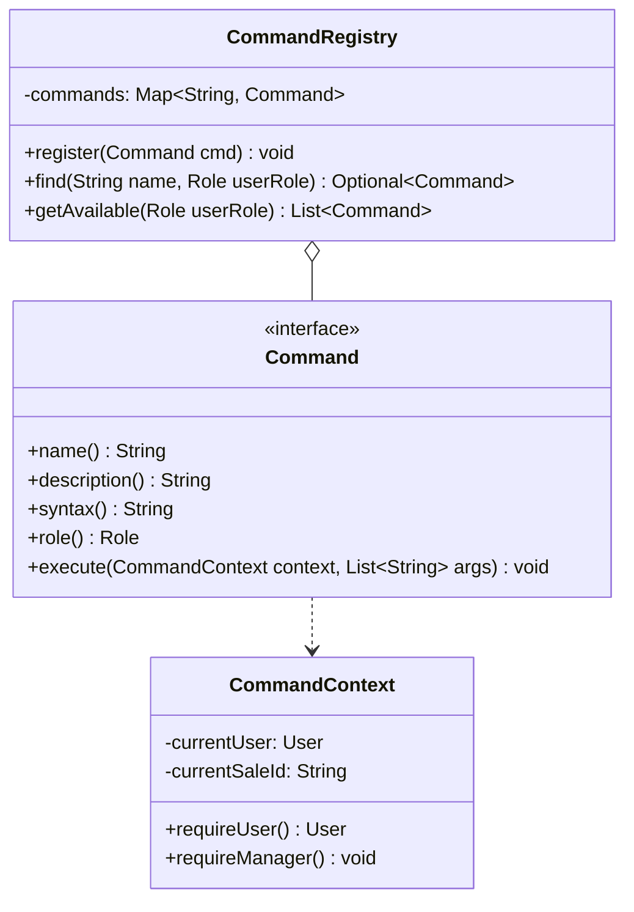
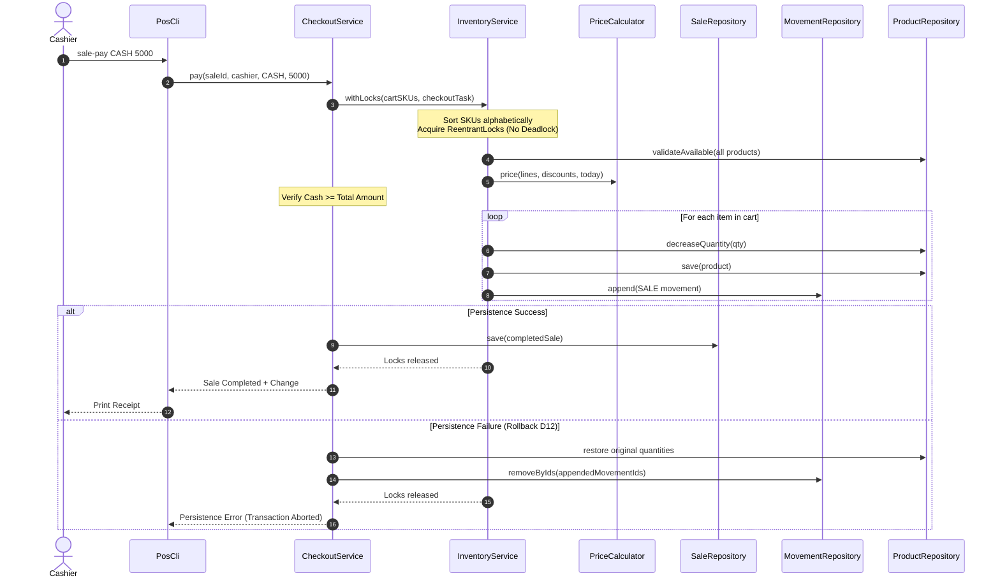

# RetailCore Architecture & Design Patterns

This document details the software architecture, design patterns, and concurrency model of **RetailCore**, an enterprise console Inventory and Point-of-Sale (POS) system built with Java 17, Maven, and JSON persistence.

---

## 1. System Overview & Layered Architecture

RetailCore follows a strict multi-tiered architecture with separation of concerns:

```mermaid
graph TD
    subgraph UI_Layer ["CLI & Presentation Layer"]
        CLI[PosCli - Interactive Shell]
        Parser[CommandParser - Quoted Tokenizer]
        Registry[CommandRegistry - Role-Aware Dispatcher]
        Commands[Command Implementations]
    end

    subgraph Service_Layer ["Business Logic & Coordination Layer"]
        AuthSvc[AuthService]
        CheckSvc[CheckoutService]
        InvSvc[InventoryService]
        PriceCalc[PriceCalculator]
        RepSvc[ReportService]
        AlertSvc[AlertService - Observer]
    end

    subgraph Domain_Layer ["Domain & Strategy Layer"]
        ProductModel[Product Hierarchy: Standard, Weighted, Perishable]
        SaleModel[Sale & SaleItem]
        DiscountStrategy[Discount Strategy Hierarchy]
        UserModel[User & Role]
        SupplierModel[Supplier & Category]
    end

    subgraph Persistence_Layer ["Repository & Storage Layer"]
        Repos[Repository Interfaces]
        JsonRepos[JSON Repositories]
        FileStore[JsonFileStore - Atomic Writes]
        Factories[ProductFactory & DiscountFactory]
    end

    CLI --> Parser
    CLI --> Registry
    Registry --> Commands
    Commands --> AuthSvc
    Commands --> CheckSvc
    Commands --> InvSvc
    Commands --> RepSvc
    Commands --> AlertSvc

    CheckSvc --> PriceCalc
    CheckSvc --> InvSvc
    PriceCalc --> DiscountStrategy
    InvSvc --> AlertSvc

    CheckSvc --> Repos
    InvSvc --> Repos
    AuthSvc --> Repos
    RepSvc --> Repos

    Repos <|.. JsonRepos
    JsonRepos --> FileStore
    JsonRepos --> Factories
```

---

## 2. Design Patterns

RetailCore implements five key Gang of Four (GoF) design patterns to ensure modularity, extensibility, and maintainability.

### 2.1 Strategy Pattern (Discounts)
The discount calculation engine uses the **Strategy Pattern** to apply varied pricing rules without modifying core checkout logic.

- **Interface:** `DiscountStrategy`
- **Abstract Base:** `BaseDiscount` (manages rule IDs, priority ordering, and minimum spend constraints)
- **Concrete Strategies:**
  - `PercentageDiscount`: Discounts eligible categories or products by a percentage.
  - `BuyXGetYFreeDiscount`: Implements "Buy X, Get Y Free" per decision D8 (`free = floor(qty / (X+Y)) * Y`).
  - `BulkDiscount`: Tiered unit pricing when purchased quantity exceeds a threshold.
  - `CartDiscount`: Proportional reduction across lines when the entire cart meets a minimum spend (decision D6 & D7).
- **Rule Resolution (Decision D9):** Discounts do not stack. The engine chooses the best single discount per line; ties are broken in favor of the lower rule ID.



---

### 2.2 Factory Pattern (Polymorphic JSON Serialization)
JSON documents store heterogeneous product types and discount strategies with a discriminating `"type"` field. The **Factory Pattern** reconstructs concrete domain subclasses.

- `ProductFactory`: Reconstructs `StandardProduct`, `WeightedProduct`, or `PerishableProduct` from JSON objects.
- `DiscountFactory`: Reconstructs `PercentageDiscount`, `BuyXGetYFreeDiscount`, `BulkDiscount`, or `CartDiscount`.



---

### 2.3 Repository Pattern (Data Access & Persistence)
Separates domain logic from data persistence. Repositories support atomic file writes via temporary files and `ATOMIC_MOVE` with `REPLACE_EXISTING` fallback.



---

### 2.4 Observer Pattern (Inventory Stock Alerts)
Decouples stock deduction from notification side effects. When stock falls below a product's reorder level, `InventoryService` publishes a `LowStockEvent`.

- **Subject:** `InventoryService`
- **Observer Interface:** `StockListener`
- **Concrete Observer:** `AlertService` (tracks active alerts and resolves them when stock is replenished per decision D16)



---

### 2.5 Command Pattern (Interactive CLI Shell)
Encapsulates each user action as a command object with metadata, parameter parsing, and role-based authorization.

- **Interface:** `Command` (`name()`, `description()`, `role()`, `syntax()`, `execute()`)
- **Context:** `CommandContext` (holds active user session, services, and current sale)
- **Registry:** `CommandRegistry` (filters available commands according to the authenticated user's role: `MANAGER` vs `CASHIER`)



---

## 3. Concurrency & Atomic Checkout Architecture

RetailCore guarantees thread safety, zero overselling, and deadlock freedom in high-concurrency environments.

### 3.1 Two-Phase Stock Validation & Deadlock Prevention (Decision D12)
1. **Adding Items:** Preliminary stock check provides instant user feedback. No stock is reserved while a sale is open.
2. **Completion (Checkout):**
   - All locks for items in the cart are sorted alphabetically (`TreeSet<String>`) before acquisition. This strictly prevents circular-wait deadlocks.
   - All stock quantities and perishables are re-validated atomically under lock.
   - Stock is deducted and `StockMovement` records are appended.
   - If persistence fails, an automatic rollback restores product quantities and purges newly appended movement records.



