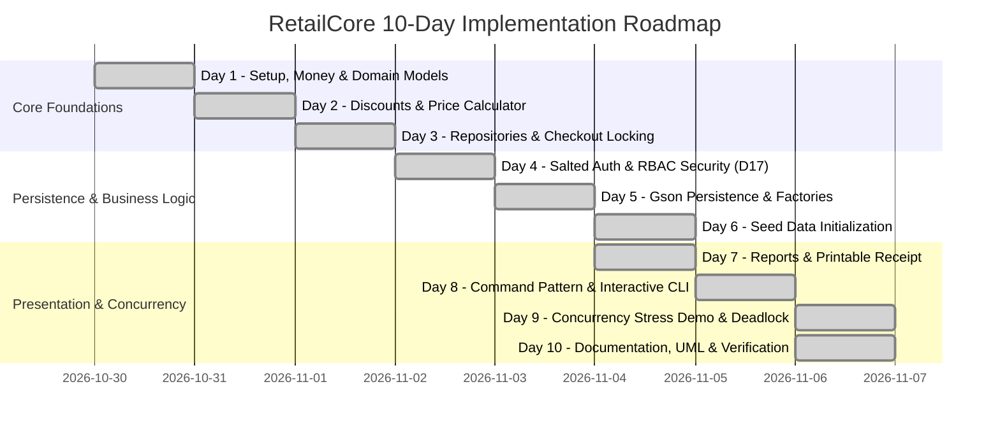

# RetailCore: 10-Day Engineering Timeline & Development Log

**Developer:** Ikedi  
**Project:** RetailCore Console POS & Inventory System  
**Institution:** Aptech Computer Education (Semester 2)  

---

## Development Milestones Summary

---

## Detailed Daily Engineering Log

### Day 1: Project Setup, Mathematical Foundation & Core Domain
- Established Maven structure (`pom.xml`) with Java 17, Gson 2.11.0, and JUnit 5.10.2.
- Created `Money` utility implementing Decisions D1, D2, and D4 (`BigDecimal` string parsing, scale 2, `HALF_UP` rounding, and `compareTo` arithmetic).
- Authored `Product` model hierarchy: `StandardProduct`, `WeightedProduct`, and `PerishableProduct`.
- Created `StockMovement`, `SaleItem`, and `Sale` domain classes.

### Day 2: Discount Strategy Pattern & Pricing Engine
- Designed the **Strategy Pattern** for promotions (`DiscountStrategy`, `BaseDiscount`).
- Implemented concrete rules: `PercentageDiscount`, `BuyXGetYFreeDiscount` (D8 formula), `BulkDiscount`, and `CartDiscount` (proportional distribution D6).
- Created `PriceCalculator` enforcing decision D9 (single best discount per line, rule ID tiebreaker).

### Day 3: In-Memory Repositories & Concurrency Architecture
- Created repository interfaces: `ProductRepository`, `SaleRepository`, `MovementRepository`, and `DiscountRepository`.
- Implemented thread-safe `InventoryService` with per-product `ReentrantLock` instances and ascending SKU `TreeSet` lock ordering to eliminate deadlocks.
- Developed `CheckoutService` with two-phase stock validation (D12).

### Day 4: User Authentication, Security & Case Insensitivity
- Built `User` model, `UserRepository`, and `PasswordHasher` (SHA-256 + 16-byte `SecureRandom` hex salt).
- Implemented `AuthService`: 3-attempt account lockout, manager-only unlock, and default manager seed/reset (`--reset-manager`).
- Enforced case-insensitive uniqueness for SKUs and Supplier IDs (D18).

### Day 5: Gson JSON Persistence & Polymorphic Factories
- Built custom Gson type adapters: `BigDecimalAdapter` (strings), `LocalDateAdapter`, `LocalDateTimeAdapter`.
- Developed `ProductFactory` and `DiscountFactory` restoring subclasses via discriminator `"type"` attributes.
- Built `JsonFileStore` using atomic temporary file moves (`ATOMIC_MOVE` falling back to `REPLACE_EXISTING`) and graceful corruption error handling.
- Closed the D12 gap: automatic stock restoration and movement rollback on persistence failure.

### Day 6: Seed Data Initialization
- Created realistic seed resources: 17 Nigerian products, 4 suppliers, 5 categories, and promotional discounts.
- Implemented `DataInitializer` copying seed files to target `data/` on initial boot without overwriting existing changes.

### Day 7: Management Reports & Printable Receipt
- Implemented `ReceiptFormatter`: ASCII store receipt with items, line discounts, VAT, tendered/change, and Naira (`₦`) symbol.
- Built `ReportService` delivering 6 reports: Daily Sales Summary, Top 5 Products by Quantity, Top 5 Products by Revenue, Low Stock List, Expiring Soon, and Profit Report (D11).

### Day 8: Command Pattern & Interactive POS CLI
- Created the **Command Pattern** framework: `Command`, `CommandContext`, and `CommandRegistry`.
- Built `CommandParser` supporting quoted arguments, escaped quotes, and tokenization.
- Implemented `PosCli` interactive shell catching domain `PosException` instances and enforcing forced password change on first login.

### Day 9: Concurrency Stress Demo & CI Pipeline
- Developed `ConcurrencyDemo` proving:
  1. Zero overselling under load (50 cashiers, 150 attempts, 100 units $\to$ exactly 0 left, 50 rejections).
  2. Cross-ordered deadlock prevention.
- Added `ConcurrencyDemoTest` and configured GitHub Actions CI (`.github/workflows/ci.yml`).

### Day 10: Complete Documentation & Presentation Delivery
- Authored comprehensive Developer `README.md`, `docs/specification.md`, `docs/timeline.md`, and `docs/architecture.md`.
- Created `docs/demo-script.md` providing a 5-minute oral walkthrough for project evaluation.
- Verified 100% green test suite (119 tests, 0 failures, 0 errors).

